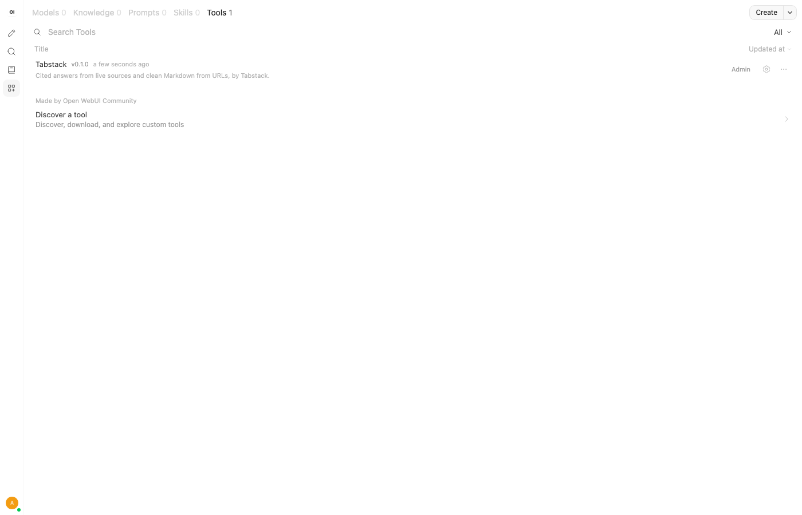
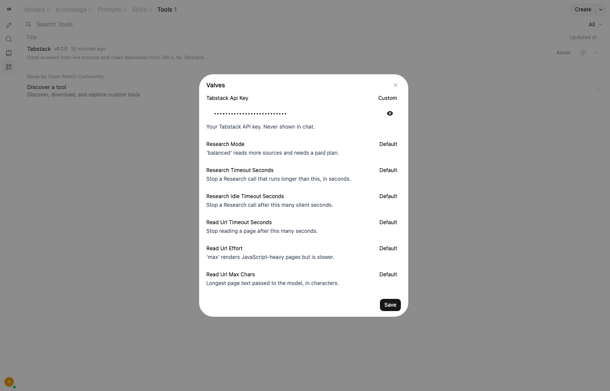
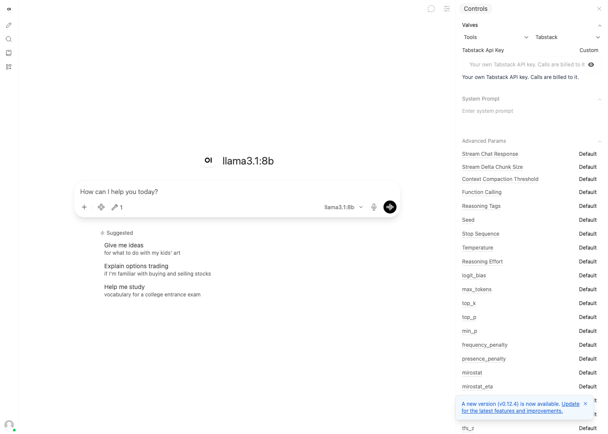
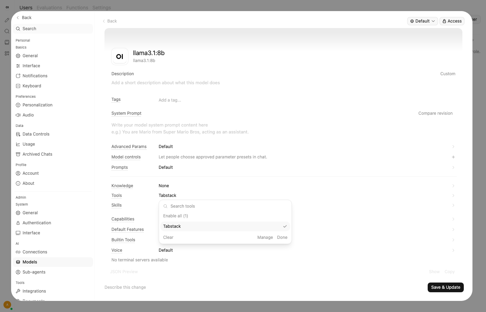
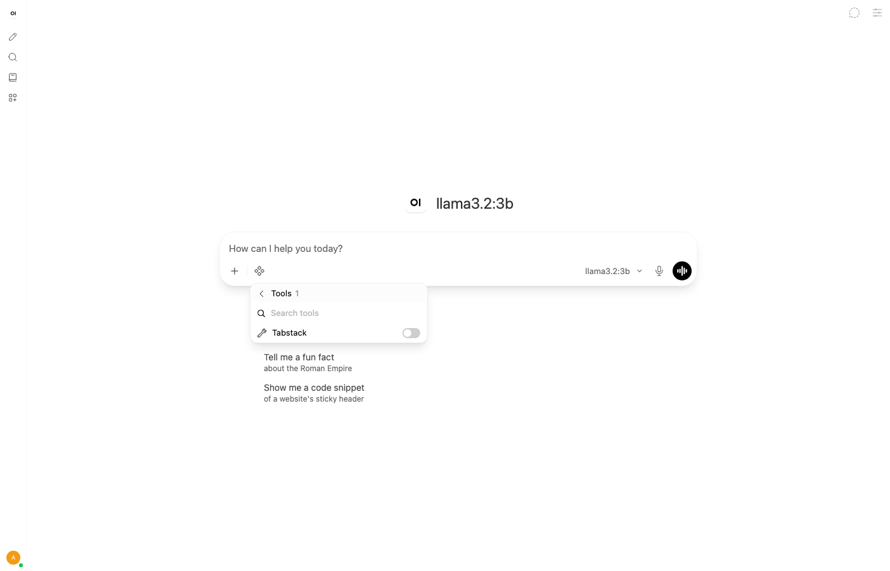
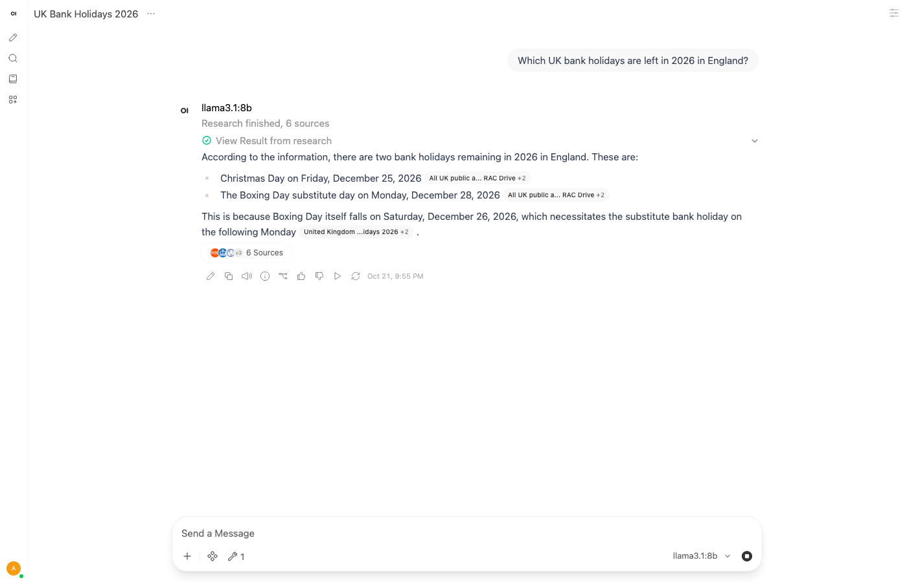
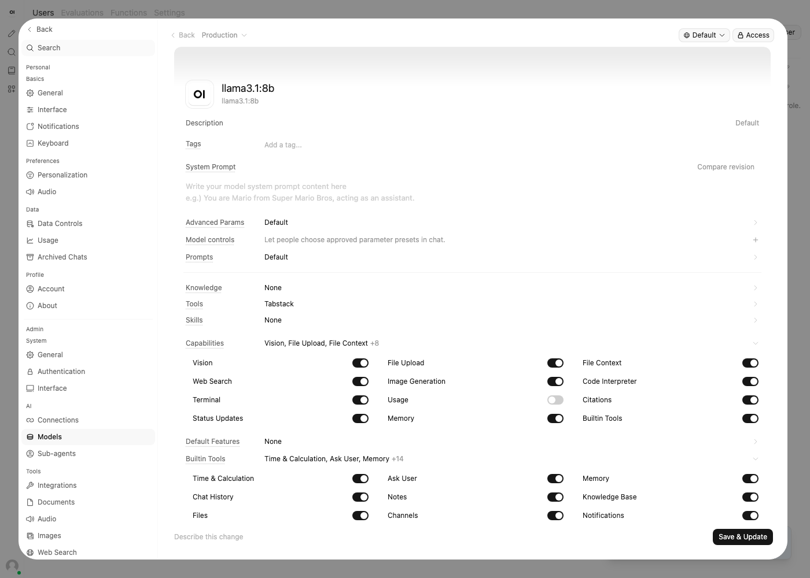
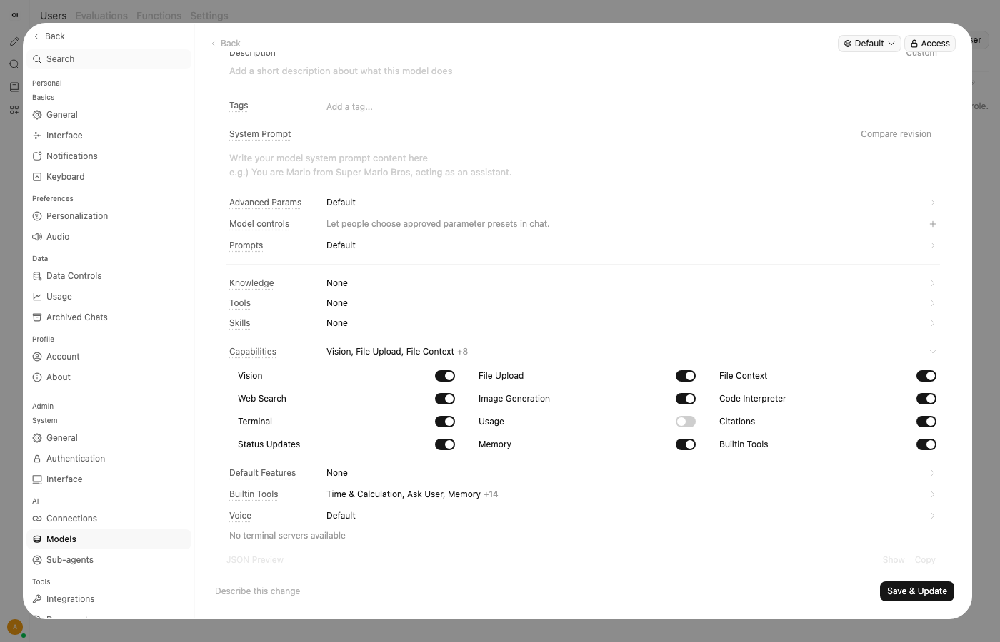

# Installing the Tabstack tool in Open WebUI

This guide is for someone who already has Open WebUI running with at least one
local model. Every step below was carried out on Open WebUI v0.12.3; the runs
are recorded in [EVIDENCE.md](EVIDENCE.md).

## Before you start

You need:

- An Open WebUI **admin** account. Workspace tools run Python on your server,
  so only admins (or users an admin trusts with that) can add them.
- A model that supports **tool calling**, for example `llama3.1:8b` or
  `qwen3:8b` from Ollama. Leave the model's function calling on its default,
  Native.
- A **Tabstack API key**.
- The Open WebUI server must be able to reach the internet, both to install
  the Tabstack SDK when you save the tool and to call Tabstack.

If your Open WebUI runs with `ENABLE_PIP_INSTALL_FRONTMATTER_REQUIREMENTS=False`
(common in multi-worker deployments), it will not install the SDK for you. Add
`tabstack==2.8.5` to your Open WebUI image first.

## 1. Add the tool

1. Open **Workspace** in the left sidebar, then the **Tools** tab.
2. Click **Create** (top right). An editor opens with a sample tool in it.
3. Open [`tabstack_tool.py`](../tabstack_tool.py), copy the whole file, click
   into the editor, select all and paste over the sample.
4. The **Tool Name**, **Tool ID** and **Tool Description** fields above the
   editor fill themselves in from the top of the file (`Tabstack`,
   `tabstack`, and a one-line description). Leave them as they are.
5. Click **Save & Create** (bottom right).
6. A **Confirm your action** dialog warns that tools can run arbitrary code.
   Read it, then click **Confirm**.

Open WebUI now installs the Tabstack SDK, which can take a little while. When
it has finished you are back on the Tools list with **Tabstack** in it.



Open WebUI runs a code formatter over tool code when you save it. The file is
already in that format, so nothing in it changes.

## 2. Set your API key

1. In **Workspace > Tools**, click the **gear icon** (Valves) on the Tabstack
   row.
2. The **Valves** dialog lists the tool's settings. Each one shows
   **Default** until you change it.
3. On **Tabstack Api Key**, click **Default**. It changes to **Custom** and
   a masked text field appears under it.
4. Paste your key into the field and click **Save**.



The other settings can stay on their defaults:

| Setting | Default | What it does |
| --- | --- | --- |
| Research Mode | `fast` | `balanced` reads more sources and needs a paid Tabstack plan. |
| Research Timeout Seconds | 300 | Stops a Research call that runs longer than this. |
| Research Idle Timeout Seconds | 120 | Stops a Research call if Tabstack sends nothing for this long. |
| Read Url Timeout Seconds | 60 | Stops reading a page after this long. |
| Read Url Effort | `standard` | `max` renders JavaScript-heavy pages but is slower. |
| Max Research Calls Per Reply | 1 | Research calls allowed in one reply. Later calls are refused without contacting Tabstack. |
| Max Read Url Calls Per Reply | 3 | The same for reading pages. |
| Read Url Max Chars | 20000 | Longest page text passed to the model. Longer pages are trimmed, with a note saying how much was kept. |
| Require User Key | off | Only use each user's own key; never the key above. |

**Per-user keys (optional).** Each user can add their own Tabstack key in a
chat: open **Controls** (the sliders icon at the top right), then **Valves**,
leave the first list on **Tools**, and pick **Tabstack**. Their calls then
use, and are billed to, their key. Users need the **Chat Controls** and
**Valves** permissions for this (in **Admin Panel > Users > Groups > Default
permissions**; both are on by default).


 To make that required, switch **Require User Key**
on; users without a key of their own then get a message telling them where to
add one. You can leave **Tabstack Api Key** empty in that case.

About where the key is kept:

- The key field is masked on screen, and the tool never puts the key into
  the chat.
- Open WebUI stores valve values in its database as plain text unless the
  admin sets `ENABLE_VALVE_ENCRYPTION=true` (keep `WEBUI_SECRET_KEY` stable if
  you do, or stored values become unreadable).
- Anyone you give write access to the tool can read its valves.

For how Tabstack handles the questions and pages it receives, see
[Tabstack's Trust page](https://tabstack.ai/trust).

## 3. Limit tool calls per reply (recommended)

Open WebUI lets one reply make up to 256 rounds of tool calls. In testing, a
small model called the research tool 24 times in one reply after getting good
answers, and each call is billed. The tool refuses calls beyond its own
per-reply limits (the two **Max ... Calls Per Reply** settings above), but it
is worth capping Open WebUI as well.

Set this environment variable on the Open WebUI container and restart it:

```
CHAT_RESPONSE_MAX_TOOL_CALL_ITERATIONS=3
```

With Docker Compose, add it under the Open WebUI service's `environment:`
and run `docker compose up -d` again. It is read only at start-up and cannot
be changed in the admin panel. It applies to every tool, not just this one.

Changing an environment variable recreates the container. Unless
`WEBUI_SECRET_KEY` is set, the official image generates a new secret key
inside the container when that happens (it is not kept in the data volume),
so everyone is signed out and has to sign in again. If you have turned on
`ENABLE_VALVE_ENCRYPTION`, set a fixed `WEBUI_SECRET_KEY` first, or saved
valves, including the Tabstack key, can no longer be read.

## 4. Turn the tool on for a model

**For every chat with a model (recommended):**

1. Open the user menu (your initials, bottom left) and choose
   **Admin Panel**.
2. Go to **Settings**, then **Models**, and click the model you want to use.
3. Click the **Tools** row. A picker opens; click **Tabstack**, then
   **Done**.
4. Click **Save & Update** (bottom right).



New chats with that model now start with the tool switched on. In the same
editor, leave **Status Updates** and **Citations** switched on under
**Capabilities**; the tool uses both.

**For a single chat:** under the message box, click the **Integrations**
button (next to **+**), open **Tools**, and switch **Tabstack** on.



## 5. Check that it works

1. Start a new chat with the model from step 4.
2. Ask something that needs current information, for example "What is the
   latest stable release of Node.js, and when did it come out?"
3. While Research runs, status lines appear above the reply: **Starting
   research**, **Planning searches**, **Searching, round 1 of 1**, **Found N
   new sources**, **Writing the answer**, and finally **Research finished, N
   sources**. In testing, replies that made one Research call were done
   between about 20 seconds and just over 2 minutes after sending.
4. The reply should contain the answer with source chips next to the points,
   and an **N Sources** button under it that lists the pages. Whether the
   chips appear depends on the model copying the `[n]` markers; some replies
   in testing kept only some of them.


5. To check `read_url`, paste a link and ask for a summary, for example
   "Summarise this page for me: https://docs.python.org/3/whatsnew/3.14.html".
   The status shows **Reading docs.python.org**, then **Read docs.python.org**.

If something is wrong with the setup, the tool returns a short message that
starts with `Error:`, and Open WebUI shows the tool result with a red cross.
Click **View Result** on it to read the message, for example that the key is
missing or was rejected.

## 6. If the model never calls the tool

Whether a model decides to use a tool is up to the model. The tool cannot make
it. These are the things to check, in order.

**The tool is switched on.** A wrench icon with a number appears under the
message box when tools are on for the chat. If it is missing, repeat step 4.

**Open WebUI's built-in tools are crowding it out.** By default Open WebUI
offers the model about 36 tools of its own (memory, notes, knowledge bases,
chat search, calendar, automations and more) alongside this one. In testing,
`llama3.1:8b` and `qwen3:8b` did not call the Tabstack tool in any of eight
runs while all of those were on. They called it in all 4 runs with only
**Memory**, **Knowledge Base** and **Files** left on, and in all 24 runs with
built-in tools switched off entirely (see [EVIDENCE.md](EVIDENCE.md),
sections 5 to 8 and 11). Rewording the tool's description did not help. That
is a small number of runs on two models, not a guarantee.

**Keep only the built-in tools you use (try this first).** This keeps
memories, knowledge bases and chat files working:

1. Open the model in **Admin Panel > Settings > Models**, as in step 4.
2. Click the **Capabilities** row and leave **Builtin Tools** on. A separate
   **Builtin Tools** row appears below **Default Features** only while it is
   on.
3. Click that **Builtin Tools** row to show its switches, and switch off every
   category except **Memory**, **Knowledge Base** and **Files**.
4. Click **Save & Update**.



No single category was to blame in testing: what mattered was how many tools
the model was offered. `llama3.1:8b` still called the tool with a few more
categories switched on (up to about 9 extra tools), but not with about 15
(see [EVIDENCE.md](EVIDENCE.md), section 12). Switch back on only the
categories you need, and check that the tool is still called afterwards.

**Switch built-in tools off entirely.** If the model still does not call the
tool:

1. Open the model in **Admin Panel > Settings > Models**, as in step 4.
2. Click the **Capabilities** row and switch **Builtin Tools** off.
3. Click **Save & Update**.



The trade-off: that model can no longer use any of Open WebUI's built-in
tools, such as saving memories, reading notes or searching your knowledge
bases.

**Open WebUI's own web search is on.** If an admin has enabled web search, the
model is also offered Open WebUI's `search_web` and `fetch_url`, which do
similar jobs and may be chosen instead.

**The model is too small or not trained for tools.** Asking directly ("Use the
research tool to find ...") can help. If it still never calls the tool, try a
model with stronger tool-calling support.

## Other problems

**Long pages are trimmed.** `read_url` passes the first 20,000 characters
(the **Read Url Max Chars** setting) and tells the model how much it kept.
The model only sees that part, so a question about something further down
the page may get an answer about whatever the first part covers.

**Check the facts that matter.** The tool passes on what Tabstack returns.
In testing, a page whose table came through without its date column led the
model to invent dates. The red-cross or green-tick **View Result** line in the
chat shows exactly what the tool returned.

**The model passes on the error badly, or adds things of its own.** Error
messages ask the model to repeat them word for word and not to call the tool
again for the same question. In testing the models did relay them, but one
reply also invented a claim that the tool had not provided. The red-cross
tool result in the chat always has the exact message.

**Saving the tool fails.** If pip cannot install `tabstack==2.8.5` (no
internet access from the server, or pip installs turned off), the save fails.
Install the package into the Open WebUI image and save again.

**"Current Valves are incompatible with this code".** According to the Open
WebUI documentation, this appears when new code changes a setting so that the
value already saved no longer fits. Change that setting in the Valves dialog
first, then save the code again. This was not encountered in testing.

## Updating the tool

Open **Workspace > Tools**, click **Tabstack**, select all in the editor,
paste the new file, and click **Save**. Unlike creating the tool, saving an
update shows no confirmation dialog. Your saved valves, including the key, are
kept. If the pasted file is identical to the saved one, **Save** stays greyed
out. The description shown in the Tools list is not refreshed from the new
file when you edit an existing tool; change it by hand if you want it to
match.
